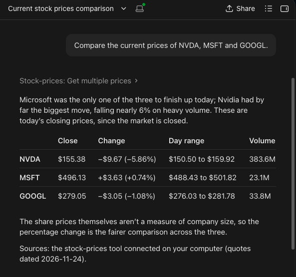
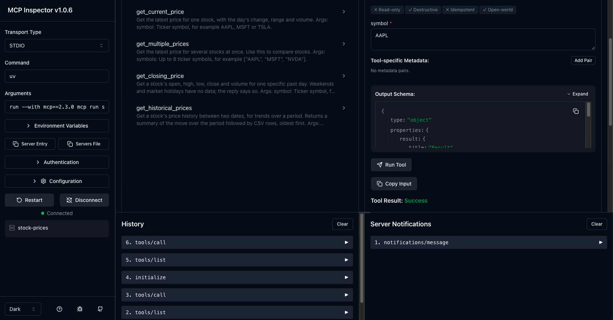
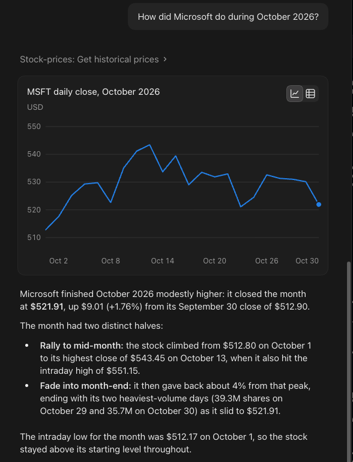

# stock-mcp

An MCP server that lets Claude Desktop (or any MCP client) look up stock prices through the [Twelve Data](https://twelvedata.com) REST API.

Ask Claude "Compare the current prices of NVDA, MSFT and GOOGL" and it calls this server instead of guessing:



## What you need

- [uv](https://docs.astral.sh/uv/getting-started/installation/) to install dependencies and run the server
- A Twelve Data API key (the free plan is enough)
- [Claude Desktop](https://claude.ai/download)
- Node.js, only if you want to use the MCP Inspector in step 3

## Step by step

### 1. Get the code and install dependencies

```bash
git clone https://github.com/JavierPachas/stock-mcp.git
cd stock-mcp
uv sync
```

`uv sync` creates `.venv` and installs the MCP SDK, `httpx` and `python-dotenv`.

### 2. Add your API key

Sign up at [twelvedata.com](https://twelvedata.com), copy the API key from your dashboard, then:

```bash
cp .env.example .env
```

Open `.env` and paste the key after the `=`, with no spaces or quotes:

```
TWELVE_DATA_API_KEY=your_key_here
```

`.env` is gitignored, so the key is never committed.

### 3. Try the server in the MCP Inspector (optional)

The Inspector is a browser page where you call the server by hand and see exactly what an MCP client sees. It is the quickest way to check that your key works.

```bash
uv run mcp dev server.py
```

In the page that opens:

1. Click **Connect**.
2. Open the **Tools** tab and click **List Tools**.
3. Select `get_current_price`, enter `AAPL` and click **Run Tool**.



Resources are under **Resources → List Templates**, and prompts under **Prompts → List Prompts**.

Press `Ctrl+C` in the terminal to stop the Inspector.

### 4. Connect the server to Claude Desktop

Claude Desktop does not use your shell's `PATH`, so the config needs full paths. Find them with:

```bash
which uv    # full path to uv
pwd         # full path to this folder
```

Open Claude Desktop's config file, creating it if it does not exist:

- macOS: `~/Library/Application Support/Claude/claude_desktop_config.json`
- Windows: `%APPDATA%\Claude\claude_desktop_config.json`

Add a `stock-prices` entry under `mcpServers`, using your two paths. Keep anything else already in the file.

```json
{
  "mcpServers": {
    "stock-prices": {
      "command": "/full/path/to/uv",
      "args": ["run", "--directory", "/full/path/to/stock-mcp", "server.py"]
    }
  }
}
```

The key does not go in this file. The server reads it from `.env`.

### 5. Restart Claude Desktop

Quit the app completely (`Cmd+Q` on macOS; closing the window is not enough) and open it again. It only reads the config at startup.

### 6. Ask about stocks

Start a new chat and ask a question. Approve the tool call the first time Claude asks.

- "What's Apple trading at right now?"
- "Compare the current prices of NVDA, MSFT and GOOGL."
- "What did Tesla close at on 2026-11-13?"
- "How did Microsoft do during October 2026?"



## What the server provides

**Tools**, which Claude calls on its own:

| Tool | What it returns |
|---|---|
| `get_current_price(symbol)` | Latest price, today's change, day range and volume |
| `get_multiple_prices(symbols)` | The same for up to 8 symbols in one call |
| `get_closing_price(symbol, date)` | Open, high, low, close and volume for one past day |
| `get_historical_prices(symbol, start_date, end_date, interval)` | A summary and CSV rows for a date range; `interval` is `1day`, `1week` or `1month` |

**Resources**, the same data addressed by URI:

- `stock://{symbol}/price`
- `stock://{symbol}/closingdate/{date}`
- `stock://{symbol}/history/{start_date}/{end_date}`

**Prompts**, ready-made requests you can pick in the client: `current_price`, `closing_price`, `historical_prices` and `usage_guide`.

Symbols are ticker symbols such as `AAPL`. Dates are `YYYY-MM-DD`.

## How the code is organised

| File | Role |
|---|---|
| `stock_formatter.py` | Calls the Twelve Data REST API with `httpx` and formats the results as text. It has no MCP code. |
| `server.py` | The MCP layer. Each tool, resource and prompt is a thin wrapper around a function in `stock_formatter.py`. |

To add a capability, write a plain function in `stock_formatter.py`, then wrap it in `server.py` with `@mcp.tool()`, `@mcp.resource(...)` or `@mcp.prompt()`. The tool's docstring is what Claude reads to decide when to call it.

The server uses version 2 of the MCP Python SDK, where the class older tutorials call `FastMCP` is named `MCPServer`.

## If something goes wrong

| What you see | What to do |
|---|---|
| `TWELVE_DATA_API_KEY is not set` | Check that `.env` is in this folder and has the key after the `=`. |
| `You have run out of API credits for the current minute` | The free plan allows 8 requests per minute, and each symbol counts as one. Wait a minute. |
| The server does not appear in Claude Desktop, or shows as failed | Check that both paths in the config are full paths, then quit and reopen the app. |
| Claude answers without calling a tool | Open the tools menu below the message box and check that `stock-prices` is switched on. |
| `npm error ... EACCES` when starting the Inspector | Your npm cache has files owned by root. Run `sudo chown -R $(id -u):$(id -g) ~/.npm`. |

On macOS, Claude Desktop writes the server's log, including any startup error, to `~/Library/Logs/Claude/mcp-server-stock-prices.log`.
